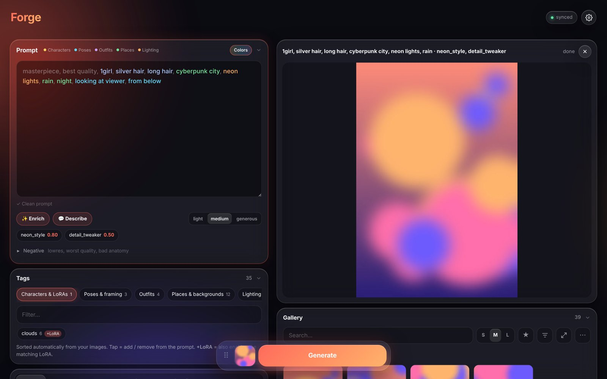
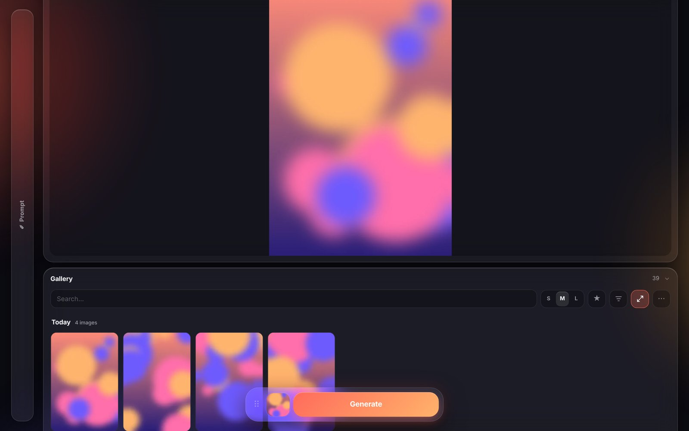
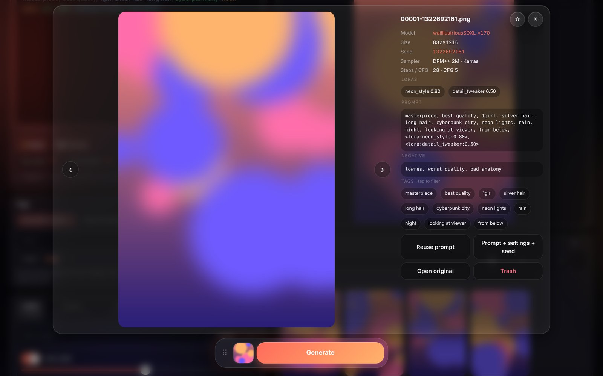
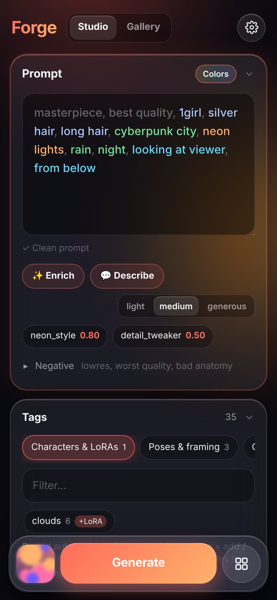
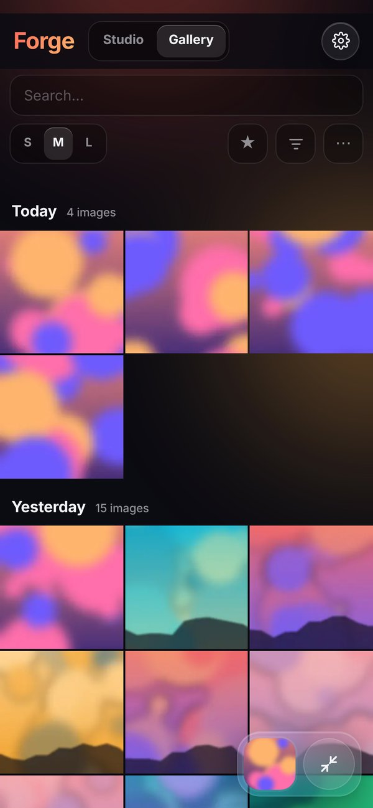
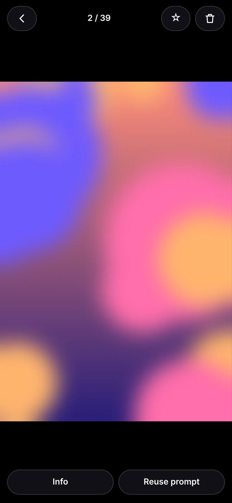

# Forge Mobile

A modern, touch-friendly web UI for **Stable Diffusion WebUI Forge**: generate from your phone or desktop, with a shared prompt, a generation queue and a fast gallery.

It installs as a regular Forge extension and serves its own page at `/mobile/`, next to the classic Gradio UI (which keeps working).

> The UI is available in **English** and **French** (auto-detected from your browser, switchable in ⚙️ Settings).

## Screenshots

### Desktop

| Wide gallery | Image viewer |
|---|---|
|  |  |

### Mobile

  
  &nbsp;
  
  &nbsp;
  

## Features

**Prompting**
- Prompt shared live between all your devices (start on the PC, tweak from the couch)
- Tag highlighting by category (characters, poses, outfits, places, lighting…)
- Danbooru tag autocomplete (~140k tags, with aliases) + your Dynamic Prompts wildcards
- Prompt checker: duplicates, stray commas, unbalanced parentheses, one-click fix
- Auto-built **tag library** from your own images' metadata, with "+LoRA" links for character tags
- **TIPO** (optional, local, CPU): suggests extra Danbooru tags or turns a sentence into tags — shown as chips, never rewrites your prompt
- Presets (choose whether they include prompt / negative / LoRAs)

**Generation**
- Server-side **queue**: stack jobs from any device, reorder, pause / resume, cancel, restore any past prompt & settings
- Live progress + preview, floating draggable Generate button (snaps back to center)
- LoRAs: active / inactive split, weights, trigger words, drag & drop import, **Civitai search & download**
- Hires fix with optional tiled VAE decode (avoids VRAM freezes on 8 GB cards)
- Notifications via [ntfy](https://ntfy.sh) (phone push, even screen off)
- Restart Forge / free VRAM from the UI

**Gallery**
- Indexes the PNG metadata of your outputs: search, filter by LoRA / model / date / tags, favorites
- Justified grid with S/M/L sizes, pagination, date grouping, fast WebP thumbnails generated in the background
- Viewer with full metadata, "reuse prompt" / "reuse everything"
- Mobile: dedicated **Gallery tab** and a **photo mode** (swipe, pinch-zoom, swipe-down to close)
- Trash instead of delete (`outputs/_corbeille`, with undo), duplicate & grid cleanup

## Requirements

- **Stable Diffusion WebUI Forge** (tested on `f2.0.1v1.10.1`, Python 3.10) started with `--api`
- An SDXL / Illustrious / Pony checkpoint (SD 1.5 works too, the tag tools are just tuned for Danbooru-style prompts)
- A recent browser: Chrome / Edge / Firefox / Safari, desktop or mobile
- *Optional:* [Tailscale](https://tailscale.com) to reach it from your phone outside your LAN
- *Optional:* ~2 GB of free RAM and ~1 GB of disk for **TIPO** (runs on CPU, no VRAM used)
- *Optional:* a [Civitai API key](https://civitai.com/user/account) for LoRA downloads that require an account

No extra Python packages are needed for the core features: everything uses what Forge already ships.

## Install

1. In Forge: **Extensions → Install from URL** → paste this repository URL → Install
   (or `git clone` it into `webui/extensions/`).
2. Enable the API: add `--api` to `COMMANDLINE_ARGS` in `webui-user.bat`
   (add `--listen` too if you want to reach it from another device on your network).
3. Restart Forge and open **http://127.0.0.1:7860/mobile/**.

### Use it from your phone

The safest way is [Tailscale](https://tailscale.com): install it on the PC and the phone, then open `http://<pc-tailscale-ip>:7860/mobile/`.
For HTTPS (needed to install it as an app / for browser notifications), run `tailscale serve --bg 7860` on the PC and use the `https://<pc>.<tailnet>.ts.net/mobile/` address.

> ⚠️ The `/mobile` routes have **no authentication**, like the Forge API itself. Do not expose them to the internet.

### Optional

- **TIPO**: click ✨ *Enrich* once, then *Install TIPO* (installs `tipo-kgen` into Forge's Python, the model ~1 GB is downloaded on first use).
- **Civitai**: add your API key in ⚙️ to download LoRAs that require an account.
- **ntfy**: set a topic in ⚙️ and subscribe to it in the ntfy app.

## Tested with

Forge `f2.0.1v1.10.1` (Python 3.10, torch 2.3.1, Gradio 4.40), SDXL / Illustrious checkpoints, RTX 4070 Laptop 8 GB.
Other versions of Forge or A1111 may need adjustments.

## Data & files

Everything stays on your PC. The extension writes its state next to itself (`shared_state.json`, `presets.json`, `settings.json`, `queue_history.json`, `gallery_index.json`, `thumbs/`…) — all ignored by git.

## Credits

- Danbooru tag list from [a1111-sd-webui-tagcomplete](https://github.com/DominikDoom/a1111-sd-webui-tagcomplete) (MIT)
- [TIPO](https://huggingface.co/KBlueLeaf/TIPO-500M-ft) by KBlueLeaf
- Built with the help of Claude (Anthropic)

## License

MIT
